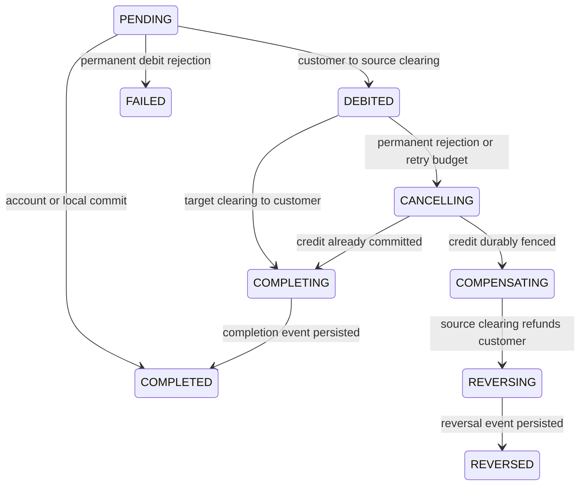

# Architecture and correctness

The API accepts durable commands into a coordinator PostgreSQL database.
Rendezvous hashing routes customer UUIDs over an ordered static shard map.
Each shard has customer, funding, and clearing accounts. All amounts are signed
64-bit minor units. Every movement writes two opposite entries and both cached
balances in one PostgreSQL transaction. Customer balances have a nonnegative
constraint, and application arithmetic checks reject integer overflow.

## Durable API intent

The coordinator stores the job and its idempotency key in one transaction.
An advisory transaction lock serializes submissions for the key. The hash
includes the route and decoded request fields. Another concurrent submission
gets 409; a different request gets 422. Successful response bytes and HTTP status
are stored once and replayed even if an original 202 later completes.

Account creation and same-shard transfers attempt execution before responding:
201 if finished, 202 if still queued. Cross-shard transfers return 202. Poll
`GET /operations/{id}` for any command or `GET /transfers/{id}` for transfers.
A deferred account response includes both its future account ID and operation ID.
Failed ledger commands return a stored 409. Submission/response transport errors
return 503; retry with the original key. All jobs, including local commands, are
recoverable after API failure. A shard and coordinator never need a distributed
transaction to register the original intent.

## Saga states

Worker replicas claim coordinator rows with `FOR UPDATE SKIP LOCKED`. They hold
the transaction lock for one bounded shard operation, then persist the next
state. This is a database-session lease: PostgreSQL releases it on connection
loss/worker death, with no lease-clock or stale-owner update race. Every shard
operation takes a per-transfer advisory lock and checks a durable step marker.
The marker, both entries, and balances commit together. A crash after shard
commit but before coordinator state update therefore causes a harmless retry.
Transient source errors retry indefinitely with capped exponential backoff;
target credit errors transition to cancellation after eight attempts.

Cancellation and credit contend on the same target-shard lock. An already
applied credit leads to completion. Otherwise cancellation persists a tombstone
that every late credit must observe, then the source can be refunded. A target
that remains unreachable must recover before cancellation can be confirmed.
Refunding while the target is unreachable would risk paying both customers.
The system prioritizes safety over a bounded time to refund during a partition.

## Outbox and consumption

Local transfers persist their terminal event inside their ledger transaction.
Cross-shard sagas persist one terminal event in the source shard before marking
the coordinator terminal. `event_id` is the transfer UUID. Relay replicas claim
rows with `SKIP LOCKED`, publish with all broker acknowledgements, and then mark
sent. A lost acknowledgement causes replay. Kafka keys use `transfer_id` for
partition affinity; the payload contains `event_id` for consumer deduplication.

The audit consumer inserts the event into `consumed_events`, whose primary key
is `event_id`, before committing the Kafka offset. A crash between those commits
causes a harmless duplicate insert. Kafka delivery is at least once. External
consumer side effects need their own transactional deduplication. Parallel relays
may reorder events for different transfers; this demo emits one terminal event
per transfer. Initial deposits create balanced entries but no transfer event.
Failed pre-debit commands emit no terminal transfer event.

## Reconciliation

Every production mutation worker takes a shared coordinator advisory lock.
The reconciler briefly takes the exclusive lock to stop new ledger steps, then
reads each shard under repeatable read. It verifies cached balances, the global
zero sum, and total clearing against durable applied debit/credit/refund markers
joined to coordinator transfer amounts. It also checks terminal saga markers and
forbids a transfer having both credit and refund. This accounts for shard commits
whose coordinator update was lost. It reports outbox lag and nonterminal jobs
older than one minute. Account jobs are included in that backlog.

The barrier does not make the ledger depend on reconciliation: ordinary steps
run concurrently when no reconciliation is active. The scan is an explicit
throughput tradeoff for this demonstration. It reads all historical steps/jobs
and is unsuitable for an unbounded production dataset without incremental
checkpoints. Unreachable shards set reconciliation success to zero; a previous
zero mismatch value alone is not proof of a fresh successful check.

## Limits

Single currency; no FX, external banking, per-user authorization, account closure,
or online shard rebalancing. Bootstrap deposits are an administrative demo
capability behind the shared API key. Keep the stack bound to localhost.
Database and Kafka volumes survive container restarts; coordinator durability
and Kafka replication are single-node demo configurations. Simultaneous disk
loss is outside this model. Static shard order/count must never change against
existing accounts; use isolated new projects for scaling experiments. Pinning
container image digests, rotating credentials, TLS, backups, high availability,
and hardened deployment are future production work.
